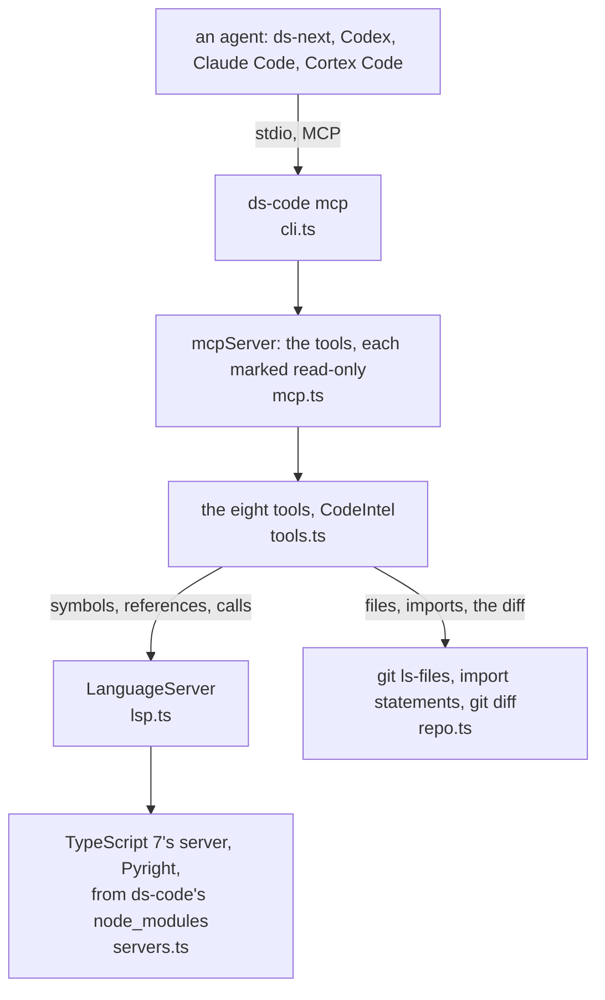

# Architecture

How `ds-code` is put together: what happens when an agent calls a tool, the rules the code keeps,
every file and what it holds, and where to make a given change. `test/architecture.test.ts` fails when
a file is added, moved or deleted without this page following, so the map below is always complete.

## A call, end to end

1. **The agent starts the server.** It runs `ds-code mcp` in the repo it works in (or `ds-code mcp DIR`),
   as configured in its MCP settings, and keeps it for the session.
2. **A call.** `mcp.ts` hands the arguments to the tool in `tools.ts`; `CodeIntel` turns a name into
   positions and asks the language server for the file's language.
3. **The server.** The first call for a language starts its server (`servers.ts`), which loads the
   project; later calls reuse it. `repo_overview` and the diff half of `change_impact` need no server.
4. **The answer.** Text the model can act on: paths relative to the repo, lines, the line of code.
   Anything that goes wrong comes back as a result that starts with `ERROR:`, never as a crash.
5. **The end.** When the agent hangs up (it closes stdin, then sends SIGTERM), the language servers stop
   and so does ds-code.

## Rules the code keeps

- **Every tool reads.** Each is marked read-only (and not destructive), so a client runs it without
  asking. A tool that writes does not belong here.
- **Nothing the repo carries runs.** Pyright is given a `.venv`'s package folders, never its `python`,
  which Pyright would run; `git diff` runs with no external diff and no textconv.
- **Nothing outside the repo is read but a library, and the canon's index.** A file reached through a
  link out of the repo is outside it (`repo.realWithin`), and so is a caller in a file a `tsconfig.json`
  brings in from outside: it is counted, never named. The one other read is the canon's `index.json`
  (`src/graph.ts`), at `DS_CANON` or beside the team's repos, never at a path the repo names.
- **Nothing is installed on the machine beyond `npm install`, and nothing leaves it.** Both servers
  come from ds-code's own `node_modules`; neither makes a network request.
- **Missing pieces never crash.** A server that stops is started again on the next call; one that
  takes too long says so. Outside a git repo, `change_impact` says so.

## Every file

| File | Holds |
|---|---|
| `src/cli.ts` | The `ds-code` command: `ds-code mcp [DIR]` serves on stdio, for the repo at DIR or here, until the agent hangs up; `-v`, and help |
| `src/mcp.ts` | `mcpServer`: the tools as an MCP server named `code`, each marked read-only; closing it stops the servers |
| `src/tools.ts` | The eight tools (`find_symbol`, `references`, `callers`, `callees`, `file_symbols`, `definition`, `repo_overview`, `change_impact`) and `CodeIntel`, which asks the servers and shapes the answers |
| `src/lsp.ts` | `LanguageServer`: a small LSP client over stdio (Content-Length framing, requests, the client's answers to the server), `openFile`, and `diagnosed` for when a file's diagnostics arrive |
| `src/servers.ts` | Which server reads which file, and how to start each from ds-code's `node_modules`: TypeScript 7's `tsc --lsp`, Pyright's `pyright-langserver`; the project's `.venv` package folders for Pyright (`packagesIn`), never its python |
| `src/graph.ts` | The cross-repo graph (canon adr-002): the `repos` section of the canon's `index.json`, the repo's name from its manifest, and the `Across repos` lines `change_impact` adds: the contracts this repo provides that a change touches by name, and who uses each |
| `src/repo.ts` | What needs no server: the repo's files (`git ls-files`), the files that mention a name (`mentioning`, `git grep`), its import graph and entry points for `repo_overview`, the lines `git diff` says changed for `change_impact`, and `within` and `isFile` for paths |
| `test/code.test.ts` | The tools against the real servers: the two fixture projects, a file no tsconfig includes, a git repo with changes, this repo (its tests included); the MCP server; the safety rules above; imports and resolution |
| `test/architecture.test.ts` | That this page names every file, and names no file that is gone |
| `test/fixtures/code-ts/package.json`, `test/fixtures/code-ts/tsconfig.json`, `test/fixtures/code-ts/src/greet.ts`, `test/fixtures/code-ts/src/main.ts` | A small TypeScript project: `greet`, `shout` which calls it, `run` which calls both |
| `test/fixtures/code-py/pyproject.toml`, `test/fixtures/code-py/pkg/__init__.py`, `test/fixtures/code-py/pkg/greet.py`, `test/fixtures/code-py/pkg/main.py` | The same project in Python |

## Where to change what

| To change | Go to |
|---|---|
| A tool, or what one answers | `TOOLS` and `CodeIntel` in `src/tools.ts`; a new tool is a new entry in `TOOLS` |
| A language the tools read | `EXTENSIONS` and `serverSpec` in `src/servers.ts`, with a server that speaks LSP over stdio and installs from npm |
| What the MCP server says about its tools | `src/mcp.ts` |
| The command | `src/cli.ts` and its `HELP` text |
| What `change_impact` says about other repositories | `crossRepo` in `src/graph.ts`; the data comes from canon's `scripts/build_repos.py` |

## The servers

- **Which.** TypeScript 7's native language server (`tsc --lsp --stdio`, from the `typescript`
  package) for TypeScript and JavaScript; Pyright (`pyright-langserver --stdio`, from the `pyright`
  package) for Python. Both are Microsoft's, Apache-2.0 and MIT, and both come with `npm install`, so
  a registry mirror such as Nexus is all they need.
- **Starting and stopping.** A server starts on the first tool call for its language and stays until
  the agent closes the connection. The first call loads the project: under a second here, a few
  seconds on a large repo. Pyright answers from its open files alone until it has found the rest, so
  the first call waits for its first diagnostics, which come once it has (30 s at most).
- **What each server sees.** TypeScript's searches only the projects it has loaded: the nearest
  `tsconfig.json`'s files, and the files opened. So before `references` and `callers`, ds-code opens the
  repo's other files that mention the name (`git grep`), and uses in tests or scripts outside every
  `tsconfig.json` are found too. Pyright resolves the repo's own modules always, and installed packages when
  the repo has a `.venv` or `venv` (their `site-packages` and the folders their `.pth` files add, read,
  never run) or `python` is on the PATH.

## Keeping this page true

- Add, move or delete a file: update the map above in the same change. `npm test` fails until you do.
- Change how a call flows or break one of the rules above: update that section, and record why in
  `DECISIONS.md`.
- Every change also gets a line in `CHANGELOG.md`. `AGENTS.md` says the same to any agent working here.
