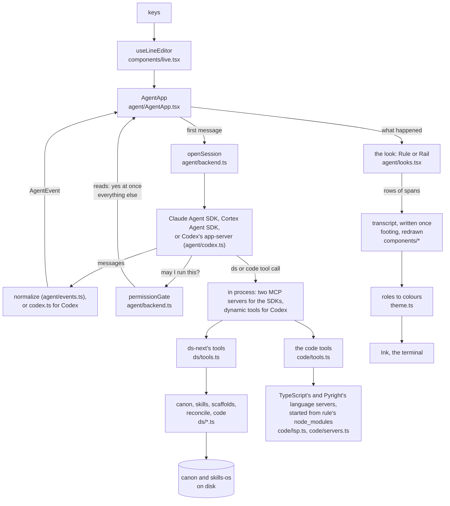

# Architecture

How `rule` is put together: what happens when you type, the rules the code keeps, every file and
what it holds, and where to make a given change. `test/architecture.test.ts` fails when a file is
added, moved or deleted without this page following, so the map below is always complete.

## A turn, end to end

1. **You type.** `useLineEditor` keeps the line and the `/` menu. Enter hands the line to `AgentApp.run`.
2. **Local or agent.** `/status`, `/model`, `/last`, `/clear`, `/help`, `/exit` and `?` are answered
   locally. Anything else, unknown `/commands` included, goes to the agent.
3. **The session.** The first message opens a session (`openSession`). It picks the agent, serves it
   ds-next's 17 tools plus `rule_spec` as `ds` and the eight code tools as `code`, all in process, and
   starts streaming. The Claude and Cortex SDKs take the tools as MCP servers; Codex runs as `codex
   app-server` and takes them as dynamic tools (`agent/codex.ts`). Later messages reuse the session;
   after a crash or a stall the next message resumes it.
4. **Events.** The two SDKs emit the same message shapes, which `normalize` reduces to a few
   `AgentEvent`s: init, thinking, text, tool, toolResult, result, error, note. `codex.ts` reduces
   Codex's thread items and turn notifications to the same events.
5. **Asking.** Before a tool runs, the SDK calls `permissionGate`; Codex sends an approval request,
   or calls the ds tool, and `codex.ts` puts it through the same gate. Reads in the allowlist pass at
   once; anything else goes to `AgentApp.askPerson`, one question at a time, and the look draws it,
   whole. A session that ends takes its questions with it: the one showing is declined and the ones
   queued behind it never show, and nothing an ended session sends afterwards touches the next.
6. **Drawing.** For each event `AgentApp` asks the look for rows (`text`, `toolStart`, `toolEnd`,
   `ending`...) and prints them to the transcript. Only the running tools, the spinner and the box
   redraw.
7. **Colour.** Rows carry roles (`accent`, `muted`, `warn`...), not colours. `theme.ts` turns a role into
   a colour for the look, the theme (dark or light) and what the terminal supports.

## Rules the code keeps

- **A line is data.** A `Row` is a list of `Span`s, each with a colour role (`text.ts`). Builders return
  rows; components only render them. Tests measure every row without a terminal.
- **Text never styles itself.** `s()` and `row()` draw control characters as symbols (ESC as `␛`), so
  a model's or a tool's `ESC[8m` cannot hide part of a command from the person approving it. Rows
  carry no escape codes of their own; colour is a role.
- **Colour is a role, never a hex value in a builder.** Palettes live in `tokens.ts` (Rule) and
  `rail/tokens.ts` (Rail); `theme.ts` resolves them at truecolor, ANSI-16 or no colour.
- **Nothing printed is reprinted.** The transcript goes through Ink's `<Static>` (`components/transcript.tsx`);
  only the footing redraws. This is [[terminal-design]]'s "append, don't reflow".
- **The look owns all drawing in `rule agent`.** `AgentApp` never builds a row itself; it calls the
  `AgentLook` (`agent/looks.tsx`). Session, queue, watchdog and commands are shared by both looks.
- **The grid.** Frames are exactly the width they're given; other rows fit inside it. Rule draws at the
  terminal's width (60 at least); Rail draws its transcript at 60 to 80 and its box and toolbar at the
  terminal's width, as ds-next does.
- **An approval shows the whole request.** Commands, paths, URLs and other tools' arguments are
  broken to the dialog's width (`text.breakLines`), never cut or cut short, in both looks: the canon's
  gotcha-approvals, after a long command hid its tail.
- **Keys read state from refs.** A key can reach a handler from an older render. The line editor, the
  dialog and the Rail approval keep what was typed in a ref every key updates at once.
- **Two files know the agent.** `agent/backend.ts` loads the Claude or Cortex SDK; `agent/codex.ts`
  drives Codex. The rest sees `AgentEvent`s and an `AgentSession`.
- **The ds tools are ds-next's.** `ds/` is a port of ds-next's Python with the same tool names,
  descriptions, arguments and outputs. `test/parity/run.sh` runs both through 229 steps on a real
  canon and compares everything. Reads never ask; writes always do.
- **The code tools answer from language servers rule ships.** `code/` starts TypeScript 7's server and
  Pyright from rule's own `node_modules`, on the first call that needs one, and stops them with the
  session. Nothing is installed on the machine beyond `npm install`, and nothing leaves it. Every code
  tool reads; none asks. So none runs anything the repo carries: Pyright is given a `.venv`'s
  package folders, never its `python`, which Pyright would run, and `git diff` runs with no external
  diff and no textconv. And none reads outside the repo but a library: a file reached through a link
  out of the repo is outside it (`repo.realWithin`).
- **Missing pieces never crash.** No canon: each tool says what to set up. A language server that
  stops is started again on the next call; one that takes too long says so. No Cortex CLI: said at
  once, since its SDK would hang.

## Every file

### Entry point and the design-system core

| File | Holds |
|---|---|
| `src/cli.tsx` | The `rule` command: argument parsing, `--look`, `--theme`, `--color`, and the commands `tour`, `chapters`, `screen`, `spec`, `html`, `demo`, `agent` |
| `src/text.ts` | The row model: `Span`, `Row`, `s`, `bold`, `row`, width, truncate, fit, split and word wrap that keep each span's style |
| `src/tokens.ts` | Rule's tokens: palette (dark, light, ANSI-16), glyphs, spinner, verbs, grid, the canoe; the `Role` and `LookName` types |
| `src/theme.ts` | `Theme` (look, dark or light, colour depth, ground painting), `colour`, `resolve`, `ThemeContext` |
| `src/builders.ts` | Rule's message types as row builders: turn rule, you, agent, tool, result, thinking, outcome, facts, frame, dialog, input box, status row, popup, banner |

### Rule's walkthrough

| File | Holds |
|---|---|
| `src/spec.ts` | Rule's spec as data: principles, colour roles, glyphs, grid, motion, mascot, code map, screens, known gaps |
| `src/screens.ts` | Rule's seven screens and the spec page's mockups, built from `builders.ts` |
| `src/tour/chapters.tsx` | The 19 chapters of `rule tour` |
| `src/tour/Tour.tsx` | The pager (enter for the next chapter, q quits) and `ChapterView` |
| `src/tour/doc.tsx` | Prose pieces: headers, paragraphs, label/value pairs, tables, mockups in dark and light |
| `src/tour/rail.tsx` | `RailScreen`: one Rail screen with its note, for `rule screen --look rail` |
| `src/html.ts` | `rule html`: the tour as one page (`build`), or Rail's screens (`buildRail`) |
| `src/html-page.ts` | The two page templates: Rule's Modernist chrome and Rail's |

### Components

| File | Holds |
|---|---|
| `src/components/Lines.tsx` | `Line` and `Lines` (rows to Ink `<Text>`), and `Mock`, a mockup painted on its theme's ground |
| `src/components/rule.tsx` | Rule's static components, each a thin wrapper over a builder |
| `src/components/live.tsx` | What redraws: `Working` (spinner line), `useLineEditor`, `InputBox`, `Footing`, `DialogPicker` |
| `src/components/transcript.tsx` | `useTranscript` and `Transcript`: the write-once log on `<Static>` |
| `src/components/LiveTurn.tsx` | Rule demo's faked turn: thinking streams, tools run and land |

### Demos

| File | Holds |
|---|---|
| `src/demo/Demo.tsx` | `rule demo` in Rule: the faked session with the closed box, popup, live turn and dialog |
| `src/demo/scripted.ts` | The scripted agent behind `rule demo --look rail`, played through the real `AgentApp` |

### The agent terminal

| File | Holds |
|---|---|
| `src/agent/AgentApp.tsx` | `rule agent`: the session, local commands, the queue, interrupts, the stall watchdog, approvals one at a time |
| `src/agent/backend.ts` | Which agent (`chooseBackend`), loading its SDK, the permission gate, the in-process `ds` and `code` servers, `rule_spec`, the system prompt, `openSession` |
| `src/agent/codex.ts` | Codex: `codex app-server` over JSON-RPC, ds-next's and the code tools as dynamic tools, approvals through the gate, Codex's items as `AgentEvent`s |
| `src/agent/mcp.ts` | `rule mcp`: ds-next's tools, `rule_spec` and the code tools as a stdio MCP server, for an agent run on its own |
| `src/agent/events.ts` | `AgentEvent` and `normalize`: SDK messages from either agent reduced to a few events |
| `src/agent/looks.tsx` | `AgentLook` and its two implementations, `RULE` and `RAIL`: everything that differs between the looks |
| `src/agent/markdown.ts` | Agent Markdown as lines (`markdownLines`), and Rule's framing of it (`agentRows`) |
| `src/agent/present.ts` | How Rule names a tool, its argument, its result as a fact, and its approval dialog |
| `src/agent/desk.ts` | What this machine has (canon, skills-os, docs-ds) for the banner, and where the repo stands for Rail's toolbar |

### Rail

| File | Holds |
|---|---|
| `src/rail/tokens.ts` | Rail's tokens, ds-next's `ui_style.py` values: palette, ANSI-16, glyphs, spinner, grid, the dog and the cat |
| `src/rail/builders.ts` | ds-next's line builders ported: run, result, outcome, footer, frame, approval, banner, prompt box, menu, toolbar |
| `src/rail/screens.ts` | Rail's ten screens, built from the same `RAIL` look `rule agent` uses |

### ds-next's tools, ported

| File | Holds |
|---|---|
| `src/ds/tools.ts` | The 17 agent tools (names, descriptions, arguments), `runTool`, ds-next's system prompt |
| `src/ds/kb.ts` | `Canon` (standards, scaffolds, blocks, code index from `index.json`) and `Skills`; where they're found |
| `src/ds/scaffold.ts` | New projects from a scaffold, adopting a repo, adding a block, the pre-push hook |
| `src/ds/reconcile.ts` | `check`: a repo's manifest against the canon (adopted, declined, pending, errors) |
| `src/ds/code.ts` | `code_search`, `code_get`, `code_add`, through the Python helper |
| `src/ds/codetools.ts` | `snowflake_search`'s `cortex search`, the part of ds-next's codetools that remains (its graph and Serena are replaced by `src/code/`) |
| `src/ds/py.ts` | The bits of Python behaviour the port depends on: repr, json.dumps, path resolution, shlex, which |
| `python/code_cut.py` | ds-next's code-cutting functions, unchanged: a canon module cut down to the symbols asked for, with Python's own parser |

### The code tools

| File | Holds |
|---|---|
| `src/code/tools.ts` | The eight `code` tools (`find_symbol`, `references`, `callers`, `callees`, `file_symbols`, `definition`, `repo_overview`, `change_impact`) and `CodeIntel`, which asks the servers and shapes the answers |
| `src/code/lsp.ts` | `LanguageServer`: a small LSP client over stdio (Content-Length framing, requests, the client's answers to the server), `openFile`, and `diagnosed` for when a file's diagnostics arrive |
| `src/code/servers.ts` | Which server reads which file, and how to start each from rule's `node_modules`: TypeScript 7's `tsc --lsp`, Pyright's `pyright-langserver`; the project's `.venv` package folders for Pyright (`packagesIn`), never its python |
| `src/code/repo.ts` | What needs no server: the repo's files (`git ls-files`), its import graph and entry points for `repo_overview`, the lines `git diff` says changed for `change_impact` |

### Tests

| File | Covers |
|---|---|
| `test/rows.test.ts` | Rule's grid: every row fits, every frame is exact, the box wraps closed, the spec is complete |
| `test/live.test.tsx` | Rule's demo and tour driven by keystrokes |
| `test/agent.test.tsx` | `rule agent` in Rule with a scripted agent, events, how tools read, the permission gate, both SDKs build every tool |
| `test/rail.test.tsx` | Rail's tokens against ds-next's `ui_style.py`, its grid, its screens and page, `rule agent` and its demo in Rail |
| `test/ds.test.ts` | The ds port on a small canon: render, write, reconcile, blocks, code, tools |
| `test/code.test.ts` | The code tools against the real servers: the two fixture projects, a git repo with changes, this repo; the gate and Codex naming; imports and resolution |
| `test/codex.test.tsx` | Codex against a stand-in app-server, drawn in Rail, and end to end with the real app-server and a stand-in model; `rule mcp` |
| `test/fixtures/fake-codex.mjs` | A stand-in for `codex app-server`: one scripted turn with a ds tool call and a command approval |
| `test/fixtures/fake-model.ts` | A stand-in for the model API Codex calls, so the real app-server plays a turn with no account |
| `test/fixtures/code-ts/package.json`, `test/fixtures/code-ts/tsconfig.json`, `test/fixtures/code-ts/src/greet.ts`, `test/fixtures/code-ts/src/main.ts` | A small TypeScript project for the code tools: `greet`, `shout` which calls it, `run` which calls both |
| `test/fixtures/code-py/pyproject.toml`, `test/fixtures/code-py/pkg/__init__.py`, `test/fixtures/code-py/pkg/greet.py`, `test/fixtures/code-py/pkg/main.py` | The same project in Python |
| `test/architecture.test.ts` | That this page names every file, and names no file that is gone |
| `test/helpers.ts` | Shared: waiting for a frame, waiting for the input hooks, a scripted agent session |
| `test/parity/run.sh` | The parity check with ds-next's Python (needs a ds-next checkout, the canon and skills-os) |
| `test/parity/gen_scenarios.py` | The 229 steps, generated from the canon |
| `test/parity/run_py.py` | Runs the steps through ds-next's Python |
| `test/parity/run_ts.mts` | Runs the steps through the port |
| `test/parity/compare.py` | Compares the two runs, every output and file |

## Where to change what

| To change | Go to |
|---|---|
| A Rail colour, glyph or the spinner | `src/rail/tokens.ts` (keep it equal to ds-next's `ui_style.py`; `test/rail.test.tsx` checks) |
| A Rule colour or glyph | `src/tokens.ts` |
| How a turn reads in one look | That look in `src/agent/looks.tsx` (Rail's rows come from `src/rail/builders.ts`) |
| A third look | A new `AgentLook` in `src/agent/looks.tsx`, its tokens in `src/theme.ts`'s `INKS`, its name in `LOOKS` in `src/tokens.ts` |
| A local command (`/something`) | `COMMANDS` and `run` in `src/agent/AgentApp.tsx` |
| A key | `useLineEditor` in `src/components/live.tsx` for editing; the `useInput` in `src/agent/AgentApp.tsx` for the rest |
| Which tools never ask | `READ_ONLY` and `readOnlyIds` in `src/agent/backend.ts`; a ds tool's `readOnly` in `src/ds/tools.ts` (every code tool reads) |
| An agent tool | `src/ds/tools.ts` (port it from ds-next first; add it to `test/parity/` when it reads the canon) |
| A code tool, or what one answers | `TOOLS` and `CodeIntel` in `src/code/tools.ts`; its name in `CODE_TOOL_NAMES` there |
| A language the code tools read | `EXTENSIONS` and `serverSpec` in `src/code/servers.ts`, with a server that speaks LSP over stdio and installs from npm |
| What the agent is told | `systemPrompt` in `src/agent/backend.ts` and `src/ds/tools.ts` |
| A new agent (SDK) | `src/agent/backend.ts` (`Backend`, `chooseBackend`, `load`, `openSession`), then `normalize` in `src/agent/events.ts` if its messages differ; `src/agent/codex.ts` is the pattern for an agent with its own protocol |
| What Codex may do without asking | The thread's `approvalPolicy` and `sandbox` in `src/agent/codex.ts` |
| What `rule mcp` serves | `src/agent/mcp.ts`; its tools are the same list `rule agent` serves |
| The banner's facts | `banner` in each look in `src/agent/looks.tsx`; what the machine has in `src/agent/desk.ts` |
| A CLI command or flag | `src/cli.tsx` and its `HELP` text |
| Rule's tour | `src/tour/chapters.tsx`, its data in `src/spec.ts`, its screens in `src/screens.ts` |

## The code tools

Eight read-only tools give an agent more than text search, answered by the language servers rule
ships rather than by anything installed on the machine. `rule agent` serves them in process as `code`
beside `ds`; `rule mcp` serves both sets to Codex, Claude Code or Cortex Code run on their own, and
the repo carries that config (`.codex/config.toml`, `.mcp.json`; needs `rule` on your PATH, from
`npm link`).

| Tool | Answers |
|---|---|
| `repo_overview` | Languages, directories, the files most imported, entry points. No server; `git ls-files` and the import statements |
| `file_symbols` | A file's outline: functions, classes and members, variables, types, with lines |
| `find_symbol` | Where a name is defined, repo-wide or in one file; `Class.method` for a member |
| `definition` | Where the name on a given line is defined, a package or the standard library included |
| `references` | Every use of a symbol, by file and line, with the line of code |
| `callers` | Who calls a function, and who calls them, to a depth |
| `callees` | What a function calls, in the repo and outside it |
| `change_impact` | The uncommitted changes, symbol by symbol, where each is used, and the files that depend on the change without being changed |

- **The servers.** TypeScript 7's native language server (`tsc --lsp --stdio`, from the `typescript`
  package) for TypeScript and JavaScript; Pyright (`pyright-langserver --stdio`, from the `pyright`
  package) for Python. Both are Microsoft's, Apache-2.0 and MIT, and both come with `npm install`,
  so a registry mirror such as Nexus is all they need. Neither makes a network request; the only
  thing that leaves the machine is what the agent itself sends its model.
- **Starting and stopping.** A server starts on the first tool call for its language and stays for
  the session; `rule agent` and `rule mcp` stop them when the session ends. The first call loads the
  project: under a second here, a few seconds on a large repo. Pyright answers from its open files
  alone until it has found the rest, so the first call waits for its first diagnostics, which come
  once it has (30 s at most).
- **What each server sees.** TypeScript's follows the nearest `tsconfig.json`: files outside its
  `include` (this repo's tests, for instance) are read when asked about directly, but references
  from them to `src/` are not found. Pyright resolves the repo's own modules always, and installed
  packages when the repo has a `.venv` or `venv` (uv's and venv's places: their `site-packages` and
  the folders its `.pth` files add, read, never run) or `python` is on the PATH.
- **Codex** reads `.codex/config.toml`, once you trust the project (Codex asks the first time you open
  it). `codex mcp list` shows `ds`. When `rule agent` runs Codex, it switches that server off, since it
  serves the same tools itself.
- **Claude Code** reads `.mcp.json` and asks once before starting the server.
- **Cortex Code** isn't checked yet. Its SDK is a fork of Claude Code's and reads Claude Code's own
  config (`~/.claude.json`) besides Cortex's `mcp.json`, so it may pick up `.mcp.json` too. If `ds`
  doesn't show in Cortex's MCP list in this folder, add the server from `.mcp.json` to Cortex's
  `mcp.json`.

## Keeping this page true

- Add, move or delete a file: update the map above in the same change. `npm test` fails until you do.
- Change how a turn flows or break one of the rules above: update that section, and record why in
  `DECISIONS.md`.
- Every change also gets a line in `CHANGELOG.md`. `AGENTS.md` says the same to any agent working here.
